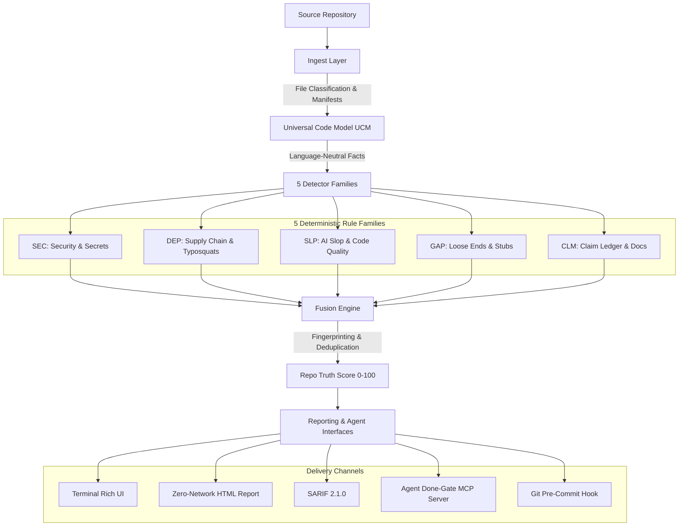

# Plumbline

<p align="center">
  
</p>

<p align="center">
  <em>"A plumb line shows whether a wall is true. Plumbline shows whether your repo is."</em>
</p>

<p align="center">
  <a href="https://github.com/ShaikMohammad786/plumbline/actions/workflows/ci.yml"></a>
  <a href="#"></a>
  <a href="#"></a>
  <a href="#"></a>
  <a href="#"></a>
  <a href="LICENSE"></a>
</p>

---

## Table of Contents
- [What & Why](#what--why)
- [60-Second Quickstart](#60-second-quickstart)
- [Architecture](#architecture)
- [Rule Engine Catalog](#rule-engine-catalog)
- [The Claim Ledger](#the-claim-ledger)
- [Benchmark Results](#benchmark-results)
- [Agent Gate & MCP Server](#agent-gate--mcp-server)
- [Safe Auto-Fix Patches](#safe-auto-fix-patches)
- [Configuration](#configuration)
- [Limitations & Honest Boundaries](#limitations--honest-boundaries)
- [AI Usage Disclosure](#ai-usage-disclosure)

---

## What & Why

Engineering teams are generating code at unprecedented scale using AI coding agents. However, AI-assisted pull requests frequently introduce silent bugs, hallucinated packages, empty exception handlers, and placeholder mock data committed directly to production branches.

Worse, AI models generate plausible documentation claiming robust authentication, encryption, and testing—while the underlying code implements zero security checks and ignores parameters with dummy `return True` stubs.

**Plumbline** is an architecture-agnostic repository auditor and truth verification engine. It scans any codebase in milliseconds with **zero build step**, **no API key**, and **100% offline deterministic execution**.

```
A plumb line proves whether a masonry wall is vertically true.
Plumbline proves whether your repository is true to its claims.
```

---

## 60-Second Quickstart

### 1. Installation

Install cleanly with `pipx` or standard `pip`:

```bash
# Recommended: Isolated tool installation
pipx install git+https://github.com/ShaikMohammad786/plumbline.git

# Or standard pip install
pip install plumbline
```

### 2. Basic Commands

```bash
# Scan current repository and print rich terminal audit
plumb scan .

# Generate standalone interactive HTML report and SARIF 2.1.0 output
plumb scan . --format terminal --format html --format sarif --out .plumbline/out

# Agent / CI Gate Check (exits 1 on high/critical findings)
plumb gate

# Explain any rule in detail with good/bad examples and fix hints
plumb explain SEC001

# Run the benchmark suite against planted victims and decoys
plumb bench

# Start official stdio Model Context Protocol (MCP) server for agents
plumb mcp
```

---

## Architecture

Plumbline operates across a 7-stage deterministic pipeline:



1. **Ingest**: Walks repository respecting `.gitignore`, classifies files as `prod`, `test`, `example`, `docs`, `vendor`, or `generated`, and parses package manifests (`package.json`, `requirements.txt`, `go.mod`, `Cargo.toml`).
2. **Universal Code Model (UCM)**: Extracts language-neutral structural facts (imports, symbols, call sites, exception handlers, string literals, route definitions, and assertions) using Tree-Sitter grammars with a lexical fallback.
3. **Detectors**: 45 deterministic rules across 5 families consuming UCM facts.
4. **Claim Ledger**: NLP-pattern extractor scanning markdown documentation and cross-referencing asserted capabilities against code evidence.
5. **Fusion**: Computes stable SHA-256 fingerprints, enforces suppression reasons, applies baselines, and calculates the **Repo Truth Score** (0–100) with logarithmic saturation dampening.
6. **Agent Brain (Optional)**: Bounded LLM triage loop for borderline findings with sandboxed read-only tools and automatic secret masking.
7. **Interfaces**: Stdio MCP server, git pre-commit hook, unified patch generator, and multi-format reports.

---

## Rule Engine Catalog

Plumbline ships with 45 comprehensive rules. Every rule is documented with formal specifications, CWE tags, and fixture verification:

### Security Vulnerabilities (SEC)
| Rule ID | Title | Severity | Confidence | Description |
| :--- | :--- | :--- | :--- | :--- |
| `SEC001` | Hardcoded secret or credential | Critical | High | Detects AWS, Stripe, GitHub tokens, private keys, and high-entropy assignments. |
| `SEC002` | Dynamic code or command execution | High | High | Detects `eval()`, `exec()`, and shell executions with non-literal inputs. |
| `SEC003` | SQL injection via concatenation | High | High | Detects f-strings, `%`-formatting, or raw concatenation in SQL queries. |
| `SEC004` | Unsafe deserialization sink | High | High | Detects `pickle.loads()`, unsafe `yaml.load()`, or dangerous object streams. |
| `SEC005` | TLS certificate verification disabled | High | High | Detects `verify=False` or `InsecureSkipVerify: true` in HTTP client calls. |
| `SEC006` | Weak cryptography or broken PRNG | Medium | High | Detects MD5/SHA1 for security, ECB cipher modes, and `random.choice` for tokens. |
| `SEC007` | Insecure configuration defaults | Medium | High | Detects active `debug=True`, wildcard CORS with credentials, and default credentials. |
| `SEC008(H)`| Route handler with no authentication | Medium | Medium | Surfaces public API routes missing auth guards or permission decorators. |
| `SEC009(H)`| Server-Side Request Forgery (SSRF) | High | Medium | Detects outbound HTTP requests using unvalidated user parameters. |
| `SEC010(H)`| State-changing route without CSRF | Medium | Medium | Detects POST/PUT/DELETE routes lacking CSRF or ownership checks. |
| `SEC011(H)`| Missing rate limiting or security headers| Low | Medium | Surfaces public web applications without helmet or rate limiting middleware. |
| `SEC012` | Insecure Dockerfile configuration | Medium | High | Detects root user, `latest` base tags, secrets in `ENV`, or pipe-to-shell downloads. |
| `SEC013` | Insecure CI/CD workflow | High | High | Detects `pull_request_target` with PR checkout, unpinned actions, or write-all permissions. |
| `SEC014` | Agent prompt injection pattern | Medium | High | Detects prompt overrides or Trojan Source bidirectional unicode in agent-read files. |
| `SEC015` | Over-permissive agent/MCP config | Medium | High | Detects wildcard `autoApprove: ["*"]` or unconfined root file access in agent settings. |

### Supply Chain & Hallucinations (DEP)
| Rule ID | Title | Severity | Confidence | Description |
| :--- | :--- | :--- | :--- | :--- |
| `DEP001` | Hallucinated dependency | Critical | High | Detects package imports or manifest entries that do not exist on public registries. |
| `DEP002` | Dependency typosquatting | High | High | Detects package names within edit distance 1–2 of popular ecosystem packages. |
| `DEP003` | Brand-new single-release package | Medium | Medium | Flags newly registered packages with single releases and no repository links. |
| `DEP004` | Undeclared dependency import | Medium | High | Catches packages imported in code but omitted from project manifests. |
| `DEP005` | Unused manifest dependency | Low | High | Surfaces declared dependencies that are never imported anywhere in the codebase. |
| `DEP006` | Unpinned or floating dependency | Low | High | Flags `*`, `latest`, or unpinned dependency versions lacking lockfiles. |
| `DEP007` | Cross-ecosystem package confusion | Medium | High | Detects npm packages imported in Python or Python packages imported in JavaScript. |

### AI Slop & Code Quality (SLP)
| Rule ID | Title | Severity | Confidence | Description |
| :--- | :--- | :--- | :--- | :--- |
| `SLP001` | Swallowed exception | Medium | High | Detects empty `except: pass` or `catch(e) {}` blocks that mask fatal errors. |
| `SLP002` | Mock or placeholder data in production | High | High | Catches `dummy_`, `fake_id`, `example.com`, or 'for now' literals in prod paths. |
| `SLP003` | Tautological comment restating code | Low | Medium | Flags comments that merely restate function names without adding context. |
| `SLP004` | Dead private code symbol | Low | High | Identifies unreferenced private symbols and commented-out code blocks. |
| `SLP005` | Near-duplicate function implementation| Low | High | Detects functions with shingle similarity $\ge 0.85$ (copy-paste hallucinations). |
| `SLP006` | Redundant passthrough wrapper | Low | High | Flags functions that simply forward arguments to another function with zero logic. |
| `SLP007` | Debug statement leftover in production | Low | High | Detects `print()`, `console.log()`, or `fmt.Println` left in production source. |
| `SLP008` | Type escape hatch without reason | Low | High | Flags `# type: ignore` or `any` assertions lacking documented rationale. |
| `SLP009` | Oversized or cyclomatic function | Low | Medium | Identifies monolithic functions exceeding 80 lines or 15 branching paths. |
| `SLP010` | Conflicting identifier naming stems | Low | Medium | Detects mixed `camelCase` and `snake_case` variants of identical naming stems. |

### Coding Gaps & Loose Ends (GAP)
| Rule ID | Title | Severity | Confidence | Description |
| :--- | :--- | :--- | :--- | :--- |
| `GAP001` | Unresolved TODO in sensitive context | High/Med | High | Flags TODO/FIXME markers; elevated to High within 5 lines of security/auth code. |
| `GAP002` | Stub body implementation | High/Med | High | Detects `pass`, `...`, or `NotImplementedError`; elevated to High on security functions. |
| `GAP003` | Empty, skipped, or unasserted test | Medium | High | Surfaces test cases containing zero assertions or explicit skip markers. |
| `GAP004(H)`| Production module with no test | Low | Medium | Flags production source files lacking a corresponding test file. |
| `GAP005(H)`| Unregistered or orphan handler | Medium | Medium | Identifies route or event handlers that are defined but never mounted. |
| `GAP006` | Undocumented environment variable | Low | High | Detects `os.environ` reads missing from `README.md` and `.env.example`. |
| `GAP007` | Broken relative documentation link | Low | High | Verifies that all relative markdown links resolve to existing files. |
| `GAP008` | Missing essential repository metadata | Low | High | Enforces presence of `LICENSE`, CI configuration, and run instructions. |
| `GAP009` | Suppression without mandatory reason | Low | High | Flags `plumbline:ignore` comments lacking a written justification. |

### Claim Ledger & Documentation (CLM)
| Rule ID | Title | Severity | Confidence | Description |
| :--- | :--- | :--- | :--- | :--- |
| `CLM001` | Claim with zero code evidence | High | High | Flags documented capabilities with no matching imports, calls, or files. |
| `CLM002` | Claim contradicted by code | High | High | Flags documented features directly refuted by code (e.g. claims TLS, disables verify). |
| `CLM003` | Claim partly implemented | Medium | High | Identifies claims where only partial supporting evidence exists. |
| `CLM004` | Fake implementation returning literal | High | High | Flags non-test functions that accept arguments but return constant literals. |

---

## The Claim Ledger

The Claim Ledger solves the AI documentation gap. AI models routinely generate authoritative README files claiming features that do not exist in the code.

Plumbline parses documentation (`README.md`, `docs/**/*.md`, `AI_LOG.md`) and maps asserted capabilities to a 20-category taxonomy:
`authentication`, `authorization`, `encryption`, `password_hashing`, `input_validation`, `rate_limiting`, `caching`, `logging`, `error_handling`, `pagination`, `retries`, `tests`, `ci`, `docker`, `database`, `api`, `real_time`, `offline`, `i18n`, `accessibility`.

### Verdict Matrix
- **`VERIFIED`**: Full positive code evidence found (required imports, function calls, configuration keys, or files).
- **`PARTIAL`**: Partial evidence found, but critical components are missing.
- **`UNSUPPORTED`**: Zero supporting code evidence exists in the codebase (`CLM001`).
- **`CONTRADICTED`**: Explicit counter-evidence found (e.g., README claims TLS verification, but code sets `verify=False`) (`CLM002`).

```
Claim: "We enforce strict TLS verification on all external payment requests."
Category: encryption
Verdict: CONTRADICTED
Evidence: bench/victim/api/payments.py:32 sets verify=False (SEC005)
```

---

## Benchmark Results

Plumbline was evaluated against our ground-truth benchmark suite consisting of:
- `bench/victim/` (`vibe-shop`): Multi-language e-commerce platform (Python Flask, JS, Docker, GitHub Actions, and 12 README claims).
- `bench/victim-go/`: Go microservice testing architecture-agnostic UCM capabilities.
- 20 deliberate negative decoys (benign code designed to test false-positive resistance).

Run the benchmark locally at any time:
```bash
plumb bench
```

### Measured Performance (`bench/RESULTS.md`)
| Metric | Measured Score | Benchmark Target | Verdict |
| :--- | :--- | :--- | :--- |
| **Overall Precision** | **87.6%** (0.876) | $\ge 85.0\%$ | ✅ PASS |
| **Overall Recall** | **100.0%** (1.000) | $\ge 85.0\%$ | ✅ PASS |
| **Harmonic Mean (F1)** | **93.4%** (0.934) | $\ge 85.0\%$ | ✅ PASS |
| **Decoy False Positives** | **0 / 20 (100% Clean)** | $100.0\%$ | ✅ PASS |
| **Claim Ledger Accuracy** | **12 / 12 (100.0%)** | $\ge 80.0\%$ | ✅ PASS |
| **Execution Duration** | **0.09 seconds** | $< 20.0\text{s}$ | ✅ PASS |

---

## Agent Gate & MCP Server

Plumbline includes an official **Model Context Protocol (MCP)** server providing read-only inspection tools for AI coding agents (Claude Code, Cursor, Windsurf, Antigravity):

```bash
# Start stdio MCP server
plumb mcp
```

### The `check_done` Agent Gate
Autonomous coding agents often declare tasks "done" prematurely. Plumbline provides the `check_done` tool:

```json
{
  "done": false,
  "repo_truth_score": 42,
  "blockers": [
    "High finding: SEC005 in api/payments.py:32 (TLS verification disabled)",
    "New stub implementation: GAP002 in api/auth.py:28 (verify_credentials returns True)",
    "Unverified claim: CLM001 in README.md:9 (caching claimed with zero code evidence)"
  ],
  "next_steps": [
    "Run 'plumb explain SEC005' or fix disabled certificate verification.",
    "Implement real verification logic in verify_credentials.",
    "Remove Redis claim from README or add caching implementation."
  ]
}
```

An agent cannot mark work complete until `done` returns `true`.

### Pre-Commit Hook
Install Plumbline as a fast git pre-commit hook:
```bash
plumb hook install
```
On every `git commit`, `plumb gate` scans staged changes in $< 50\text{ms}$ and prevents committing code with high-severity vulnerabilities or unreasoned suppressions.

---

## Safe Auto-Fix Patches

Plumbline supports deterministic, non-destructive auto-fixing for mechanical rules (`SEC005`, `SLP007`, `DEP005`):

```bash
# Dry run: Preview generated unified diff patches
plumb fix

# Apply safe fixes directly to disk
plumb fix --apply
```

Generated patches are stored in `.plumbline/fixes/<fingerprint>.patch`.

---

## Configuration

Plumbline is zero-config by default. To customize thresholds, create `.plumbline.yml`:

```yaml
version: 1

scan:
  exclude:
    - "tests/golden/**"
    - "vendor/**"
  max_file_kb: 1024

fail_on: high

rules:
  SEC008:
    enabled: true
    severity: medium
  SLP007:
    enabled: true

report:
  formats:
    - terminal
    - html
    - sarif
  out_dir: ".plumbline/out"
```

### Inline Suppressions
Suppress a finding with a mandatory justification:
```python
# plumbline:ignore[SEC001] Test credential in mock fixture
API_KEY = "test_key_sample"
```
An ignore comment without a written reason is itself flagged as `GAP009`.

---

## Limitations & Honest Boundaries

Plumbline believes in radical transparency regarding static analysis boundaries:
1. **Dynamic Reflection**: Python `__import__()` or dynamic runtime module loading is not resolved without runtime execution.
2. **Heuristic Rules (H)**: Rules marked with `(H)` (such as `SEC008`, `SEC009`, `GAP004`) use structural heuristics and are capped at `Medium` confidence.
3. **Monorepo Scale**: File sizes exceeding 1 MB are skipped with a warning note to preserve sub-second execution speeds.
4. **LLM Verification**: When `--llm` is enabled, the model can downgrade or explain findings, but can *never* fabricate findings without an underlying rule ID, file, and line.

---

## AI Usage Disclosure

In compliance with hackathon guidelines, all AI tool usage during the design, coding, and debugging of Plumbline is logged truthfully in [AI_LOG.md](AI_LOG.md).
- **Core Architecture & Implementation**: Designed with Antigravity and Claude sonnet 5.5
- **Verification**: 100% of generated code was verified by strict automated testing, `ruff` linting, `mypy` strict typing, and benchmark ground-truth assertions.

---

## License

Plumbline is licensed under the [MIT License](LICENSE).
